# India Weather Analysis & Temperature Forecasting


Analysis of 45 years of daily weather data for 8 Indian cities, a comparison of six forecasting models, and an interactive dashboard that predicts the next 12 months of temperature.

## **🔗 Live demo:** 

** Link 🔗: ** (https://india-weather-forecast-f9xb49fncz3oh5dap92bwz.streamlit.app/)


## 🎥 Demo video

[](https://drive.google.com/file/d/15PGejDQBdKRAPqAxZefCMIz7B9YvLO2l/view)

*Click the **Watch Demo Button** to watch demo (Google Drive).*

## Dashboard
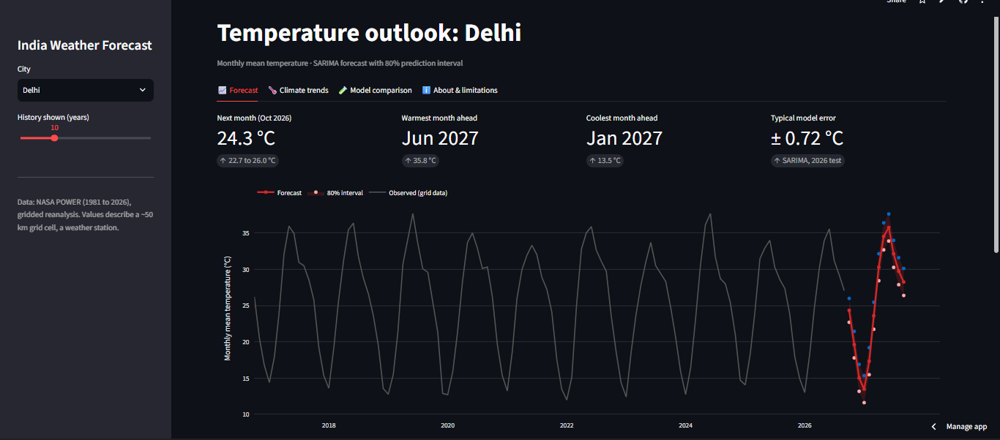

## Contents
- [Highlights](#highlights)
- [Results](#results)
- [Results gallery](#results-gallery)
- [Method](#method)
- [Project structure](#project-structure)
- [Reproduce it](#reproduce-it)
- [Deploy for free](#deploy-for-free)
- [Limitations](#limitations)
- [Future work](#future-work)

## Highlights
- **Data:** NASA POWER daily data, 1981 to 2026, for Delhi, Mumbai, Chennai, Kolkata, Bengaluru, Hyderabad, Jaipur and Shimla
- **Analysis:** STL decomposition, stationarity tests (ADF/KPSS), ACF/PACF, warming trends, hot-day counts, monsoon variability
- **Data validation:** NASA POWER compared against a second source (ERA5). The sources agree on year-to-year variability but not on long-term trends in most cities, so trend results are reported with caution
- **Forecasting:** 6 methods compared with rolling-origin cross-validation and a held-out 2026 test
- **App:** Streamlit dashboard with forecasts, uncertainty bands, climate trends and model comparison
-    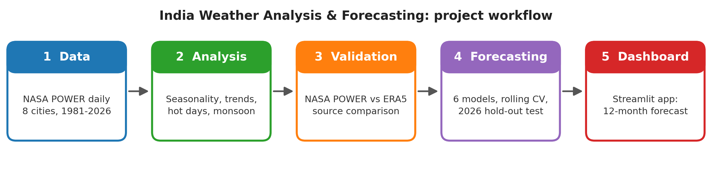

## Results

Mean absolute error in °C, all cities (lower is better):

| Model | Backtest MAE | 2026 test MAE |
|---|---|---|
| **SARIMA** | **0.81** | **0.83** |
| Climatology (10-year monthly average) | 0.84 | 0.83 |
| Prophet | 0.85 | 0.90 |
| Linear regression (trend + seasonality) | 0.86 | 0.92 |
| XGBoost | 0.97 | 1.00 |
| Seasonal naive (same month last year) | 1.16 | 1.14 |

**What I learned**
- SARIMA was the best overall model (about 27 to 30% better than the seasonal-naive baseline), with well-calibrated 80% prediction intervals (80.0% coverage in the backtest, 84.7% on 2026).
- A simple monthly average nearly matches SARIMA: monthly temperature is dominated by the seasonal cycle, and complex models such as XGBoost did not help.
- The 2026 test has only 9 months, so differences between the top models are small relative to the noise.
- NASA POWER and ERA5 disagree on long-term temperature trends in most cities, so forecasting accuracy is the main result of this project, not trend claims.

## Results gallery

### Climate analysis
| Monthly temperature by city | Warming rate per decade |
|---|---|
| 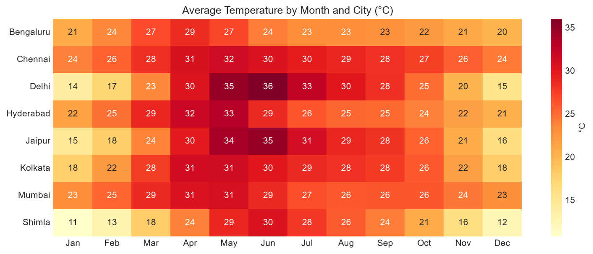 | 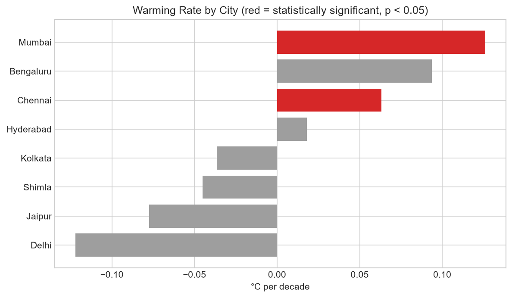 |

| Hot days per year | Monsoon rainfall variability |
|---|---|
| 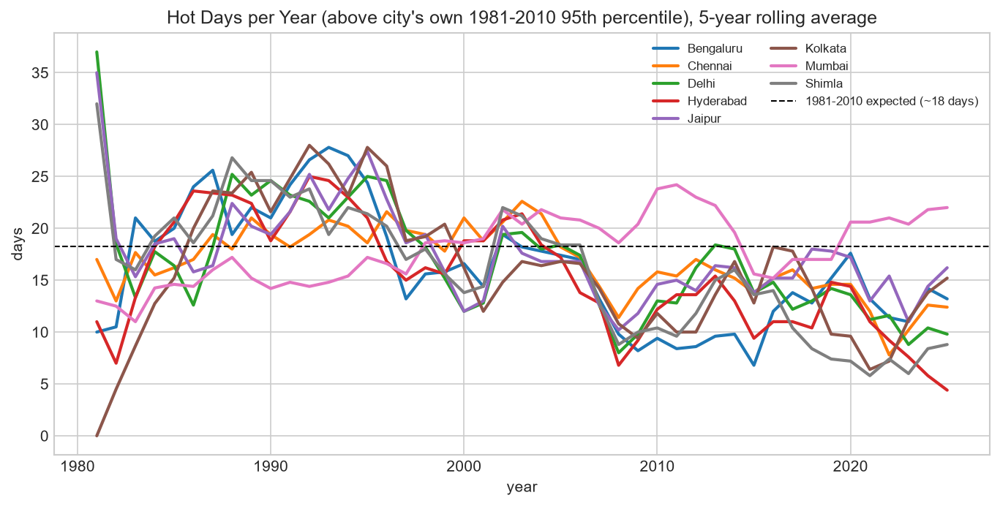 | 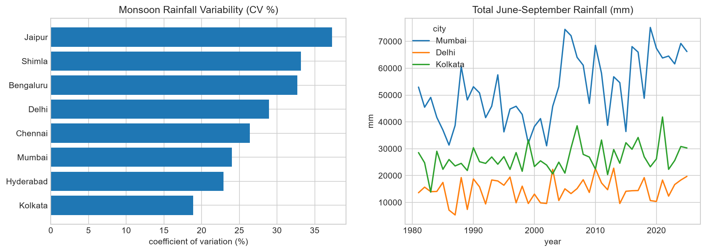 |

### Trend and seasonality (Delhi example)
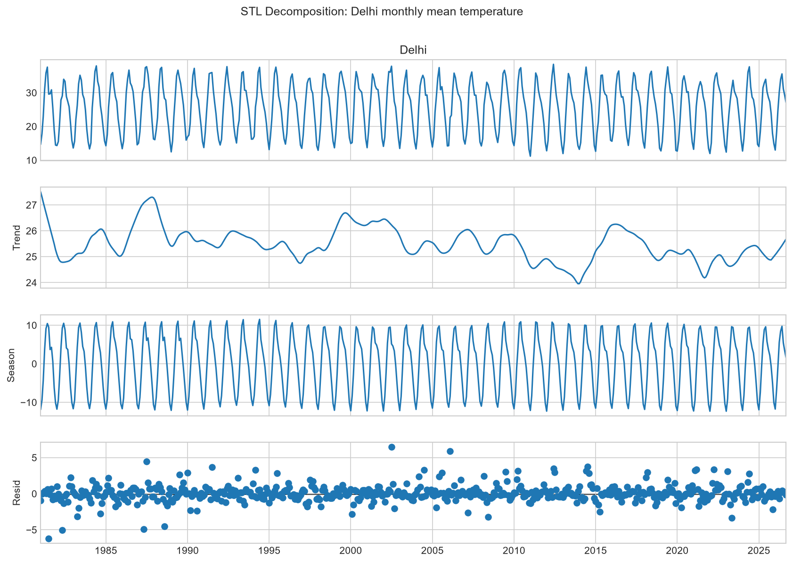

### Data validation: NASA POWER vs ERA5
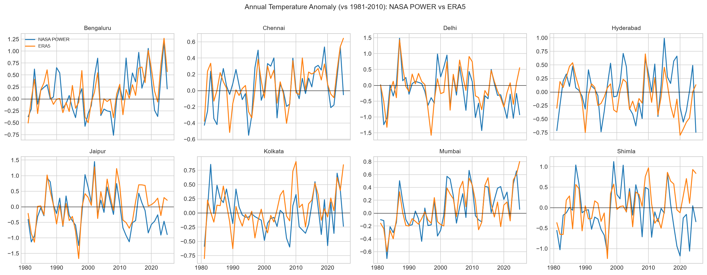

### Forecasting
| Backtest error by city and model | 2026 test error by model |
|---|---|
| 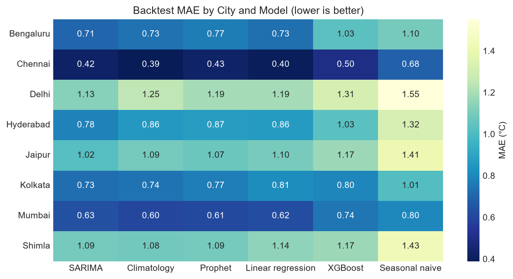 | 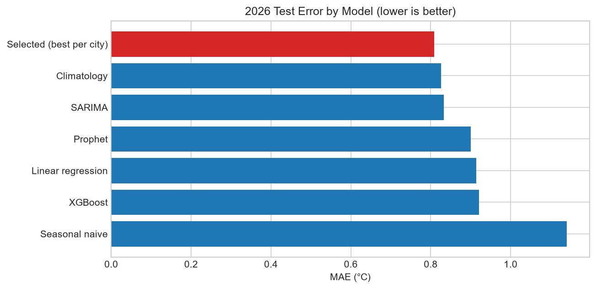 |

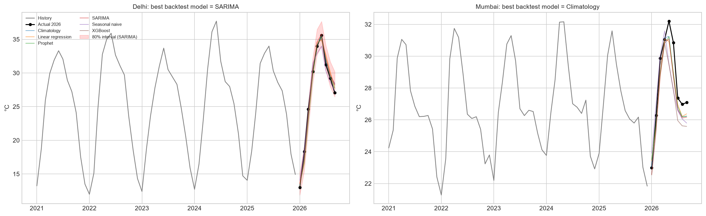

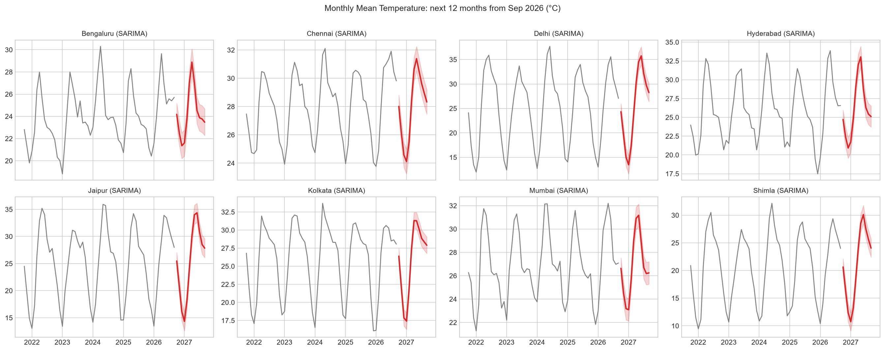

## Method
1. **Notebook 1:** download and clean daily data (NASA POWER API)
2. **Notebook 2:** exploratory analysis and validation against ERA5
3. **Notebook 3:** forecasting. Models are selected on a rolling-origin backtest (train to year Y, predict the next 12 months, repeated for 5 origins). 2026 is a final test that was never used for selection.
4. **App:** `app.py` reads the monthly data and the forecast/metric files from Notebook 3

## Project structure
```
india-weather-forecast/
├── README.md
├── LICENSE
├── requirements.txt              # app only (used by Streamlit Cloud)
├── requirements-notebooks.txt    # notebooks + app (local development)
├── app.py                        # Streamlit dashboard
├── prepare_data.py               # daily CSV -> small monthly CSV for the app
├── notebooks/
│   ├── 01_data_collection_and_cleaning.ipynb
│   ├── 02_exploratory_data_analysis.ipynb
│   └── 03_forecasting_models.ipynb
├── data/
│   ├── raw/                      # downloads (git-ignored)
│   ├── processed/                # india_weather_daily.csv (git-ignored)
│   └── monthly_temperature.csv   # made by prepare_data.py
├── reports/                      # forecasts, metrics and figures from the notebooks
│   └── figures/
├── docs/                         # LinkedIn post draft, push guide
├── scripts/                      # pre-push checks and push helper
└── .vscode/                      # VS Code settings
```

## Reproduce it
1. Install Python 3.10+ and VS Code with the **Python** and **Jupyter** extensions.
2. Open the folder in VS Code (or open `india-weather-forecast.code-workspace`). The workspace sets `jupyter.notebookFileRoot` so notebooks run from the project root.
3. Create an environment and install the packages:
   ```bash
   python -m venv .venv
   # Windows: .venv\Scripts\activate     Mac/Linux: source .venv/bin/activate
   pip install -r requirements-notebooks.txt
   ```
4. Run the notebooks **in order** (select the `.venv` kernel, then *Run All*):
   `01` creates `data/processed/india_weather_daily.csv` · `02` analysis and ERA5 validation · `03` forecasting and the files in `reports/`
5. Build the app data and launch the dashboard:
   ```bash
   python prepare_data.py data/processed/india_weather_daily.csv
   streamlit run app.py
   ```

Notebook 1 downloads data from the NASA POWER API and Notebook 2 downloads ERA5 from Open-Meteo, so you need an internet connection. Runtime is roughly 5 to 15 minutes in total.

## Deploy for free
1. Push this repo to GitHub (it must include `data/monthly_temperature.csv` and the CSVs in `reports/`)
2. Go to [share.streamlit.io](https://share.streamlit.io), sign in with GitHub and click **New app**
3. Select the repo, branch `main`, and main file `app.py`

## Limitations
- **Gridded model data, not station readings.** Each value represents a ~50 km grid cell. Absolute temperatures can be biased, especially in mountain cities such as Shimla, where the grid cell sits well below the town. The project focuses on forecasting accuracy and anomalies.
- **Monthly resolution.** The forecasts are monthly averages, not daily or weather forecasts.
- **Not an official forecast.** For warnings and official forecasts, use the India Meteorological Department (IMD).

## Future work
- Validate against IMD station data
- Daily-level forecasting with exogenous variables
- More cities and a map view

## Data sources
- [NASA POWER](https://power.larc.nasa.gov/) daily meteorological data
- [Open-Meteo](https://open-meteo.com/) historical archive (ERA5) for validation

## Tech stack
Python, pandas, statsmodels, Prophet, XGBoost, scikit-learn, Plotly, Streamlit

## License
MIT. See [LICENSE](LICENSE).
